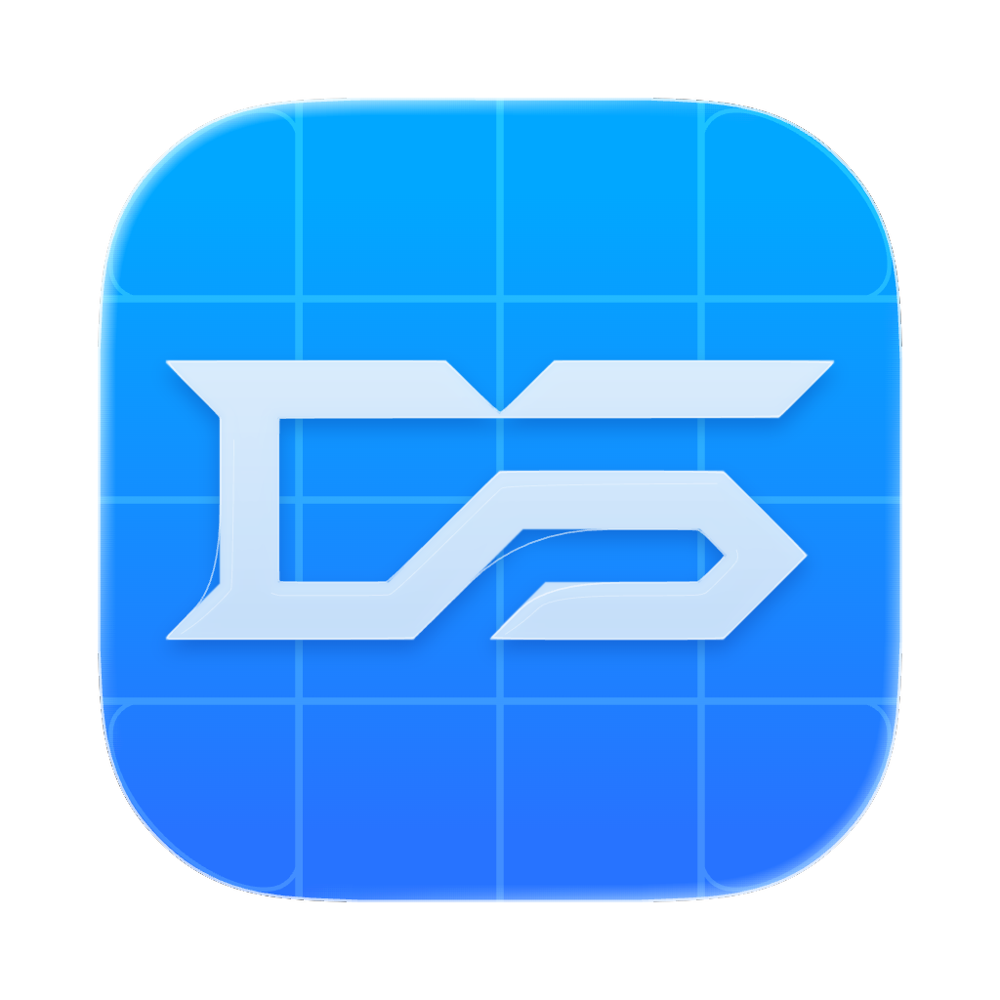

<p align="center">
  
</p>

<h1 align="center">DS Code</h1>

DS Code is my personal fork of [T3 Code](https://github.com/pingdotgg/t3code), the open source control surface for coding agents. It's my experimentation pad for new interactions and tools: ideas get tried here first, and some of them may never be more than experiments.

For installation, supported providers, and everything else T3 Code does, see the [T3 Code README](https://github.com/pingdotgg/t3code#readme).

## What's different

### UI redesign

A quieter, blue-tinted interface with an app rail, project-grouped thread cards, unified panel surfaces, and the Aspekta and Azeret Mono typefaces.

### Git Graph

A per-project graph of branches, worktrees, and the threads working on them, on web and mobile.

### Dashboard

All projects at a glance, grouped into active, working, snoozed, and settled.

## Trying it

The web app is hosted at **[dominikscholz.github.io/dscode](https://dominikscholz.github.io/dscode/)**. Like [app.t3.codes](https://app.t3.codes), it's only the interface: it connects to a T3 server running on your own machine. Pair one under **Settings → Connections → Add environment**.

A stock T3 server works, but some features here need DS Code's own server. To run everything from source, install [Vite+](https://viteplus.dev/guide/), then:

```bash
vp i
vp run dev
```

## License

The code is available under the [MIT License](LICENSE), as is upstream T3 Code by T3 Tools Inc.

The DS logo and DS Code app icons are © Dominik Scholz. All rights reserved. They are not covered by the MIT License and may not be used without permission.
